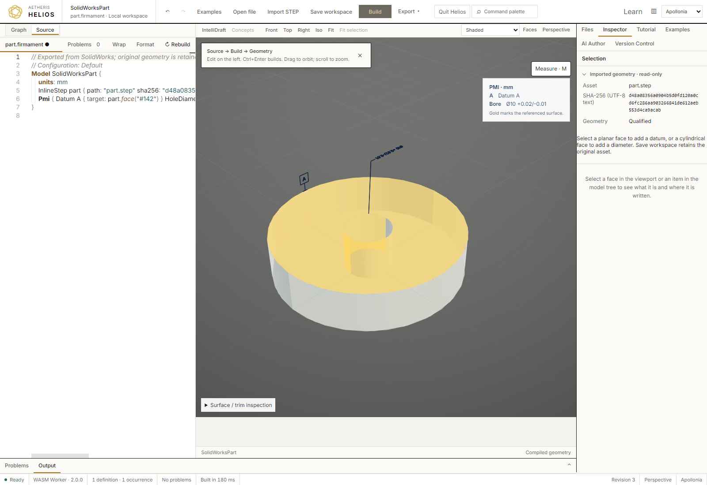

# Helios

Helios is a CAD workbench for making parts and adding manufacturing information
to STEP files. A Helios model is a Firmament file. You can edit it in the graph
or change the code and rebuild it with the [Aetheris kernel](https://github.com/yuechen-li-dev/Aetheris).

# **[Try the rolling release browser preview](https://helios-cad-wasm.yuechenli.chatgpt.site/)** 

[Download Helios 0.1.0 for Windows x64](https://github.com/yuechen-li-dev/HeliosCAD/releases/download/v0.1.0/Helios-0.1.0-win-x64.zip)

The preview runs on your device in Chrome or Edge. Download your work with
**Save source** or **Save workspace** before closing the tab.

The interface is still early. If you get stuck, [tell us on GitHub](https://github.com/yuechen-li-dev/HeliosCAD/issues/new)
what you were trying to do and what happened. A screenshot or a small model
helps if you can share one.

## Start with the bracket

1. Open **Simple bracket** in the gallery. In **Graph**, click **Top** and
   select the broad foot of the bracket.
2. Choose **Add hole on selected face**. Drag the gold ring or enter the center
   in millimeters. Click **Apply** when the preview is ready.
3. Open **Source** to see the hole you just added.

For a fillet, go back to **Graph**, click **Iso**, and switch to **Edges**.
Select the inside bend and choose **Fillet selected edge**.

**Learn** opens the manual and gives you working examples to edit alongside
the lessons. [Graph guide](https://helios-cad-wasm.yuechenli.chatgpt.site/learn#page=helios%2Fgraph-modeling.md)

## Add dimensions to a STEP part

Use **Import STEP** with a supported single-part file. In **Label**, click a
face to place a datum or a tolerance. Shift-click a second parallel face to
add a distance. You can also add notes to the part.

Export **STEP AP242** to carry supported PMI (dimensions, datums, and
tolerances) with the geometry. Export annotated **GLB** for visible 3D
callouts. **Save workspace** keeps the imported STEP file and the labels
together so you can reopen them. [Label guide](docs/public/label.md) ·
[Supported exports](docs/public/exports.md)

## Run the Windows release

Extract the entire ZIP and run **Helios.exe**. It opens the workbench in your
browser. Use **Quit Helios** to stop the local host when you're done.
[Setup and file locations](docs/public/standalone.md) · [0.1.0 release notes](docs/release/0.1.0.md)

[Build from source](CONTRIBUTING.md) · [AGPL-3.0 license](LICENSE)
