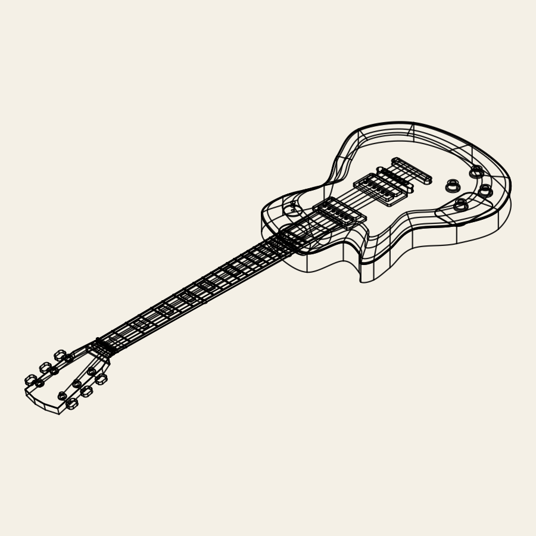

# HeliosCAD

**Aetheris Helios 0.1.0 for Windows:** [download the portable ZIP](https://github.com/yuechen-li-dev/HeliosCAD/releases/download/v0.1.0/Helios-0.1.0-win-x64.zip).
Extract the entire archive and run **Helios.exe**. It opens your existing browser,
includes its runtime, and needs no developer setup or account for local modeling.
See [getting started](docs/public/standalone.md) and the [0.1.0 release notes](docs/release/0.1.0.md).

Helios is a human-facing 3D design studio using the public `@aetheris/cad` browser runtime. Leviathan owns sign-in, accounts, project ownership, revision metadata, and object storage. Firmament source is the saved project truth; the editor rebuilds geometry and exports engineering and presentation artifacts from that source.

The **Export** picker offers STEP, GLB, USDA, STL, OBJ and PDF/SVG/PPTX drawings.
Choose one format for a direct download or several for a ZIP. Availability follows
the compiled product kind; see [export formats and limits](docs/public/exports.md).

**Learn** in the header, **F1**, or `/learn` opens the bundled Firmament manual:
searchable reference, modeling guides, and six guided lessons. Each lesson opens
its complete source in a separate practice tab, with a checklist beside the
compiled model. See [learning in Helios](docs/public/learning.md).

For maintainers: `npm run docs:sync` refreshes the offline snapshot from sibling
`Aetheris/docs/public`, linked fixture sources and Helios's public guides.
`npm run docs:check` detects content drift and runs before frontend builds;
`npm run test:learning` exercises the docs and all six lessons in the real browser
runtime. The older GitHub Pages Preview 2 snapshot is not imported as current
syntax. Firmament semantics and diagnostics remain compiler-owned.

## Concept Struct visualization

In the editor, **Concepts** toggles compiler-retained Concept Struct geometry as
gold construction wireframes. WebGPU adds a faint halo; the WebGL fallback uses
the same guides. They follow occurrence placement and motion without changing
material geometry or intercepting selection. Open Firmament source to retain
compile-time scaffolds; STEP alone does not contain them. The button is disabled
when no supported spatial Concept values are available. See Aetheris's
[shared display contract](../Aetheris/docs/public/three-telos.md#concept-struct-wireframes)
for the supported value kinds and finite guide sizes.

## Showcase and community

The [Aetheris Helios knot mark](docs/public/branding.md) is generated from
Firmament as a static GLB. `npm run branding:export` regenerates its mesh and
provenance receipt; the browser supplies the slow rotation and glow.

The root opens a curated, anonymous showcase with independently scrolling model groups. Basic contains a simple angle bracket and a paperclip; Advanced contains the original mounting plate, CODEX threaded bolt, Industrial ATLAS, sunburst electric guitar, and warm-modern house. Create personal groups of these examples, saved in this browser, or search across models and group names. Source documents load on demand; multi-file projects preserve includes, shared definitions and Scene cameras. The welcome screen does not initialize the geometry runtime. See [the showcase guide](docs/public/helios-showcase.md).

The Windows [SolidWorks integration](docs/public/solidworks.md) adds **Export to Aetheris Helios** for single-body parts: ordinary AP214 export, local Aetheris import, and a portable Helios annotation workspace. Its local stdio MCP/CLI tools also inspect, create simple extruded parts, edit dimensions, rebuild, and export through the running SolidWorks API. MBD is not used.



The front page uses bold monochrome SVG model cards, large Inter lettering and a minimal header. White Sirius is the default; Mars retains the original dark green and gold palette. Theme choice is shared with the editor and persists across reloads. Regenerate the cards with `dotnet run --project scripts/wireframes -c Release -- .`. Source and wireframe provenance is recorded in [the showcase manifest](fixtures/showcase/README.md). Browser qualification captures stay in `artifacts/local/p4-03/`.

`/discover` retains the community gallery backed by Leviathan, and `/projects` retains saved cloud projects. Community publications and anonymous forks keep their existing ownership and authentication flow. Cloud projects still store one source document; local showcase workspaces hold explicit source files in memory and download source to disk. They do not imply cloud persistence.

## Editor architecture

The active Firmament document is edited with Monaco in `src/source/SourcePanel.tsx`. Monaco owns cursor, selection, undo, indentation, and the visible markers. `src/source/FirmamentLanguageClient.ts` is the one adapter from the editor to the public Aetheris Web SDK LX contract. A separate WebAssembly Worker handles language queries so they do not block the page or wait behind a geometry build. `src/sdk/AetherisWorkerClient.ts` serializes heavy builds through its dedicated Aetheris WebAssembly Worker, retaining only the newest pending request. The SDK transfers mesh buffers and STEP bytes; the main thread keeps display, picking, project state, and save/reopen UI. Source and display revisions are shown separately, and late build results cannot replace newer source state. The selected model's source map still drives Go to Source and source cursor selection. Typing does not rebuild geometry. See [the Worker X1 report](docs/release/WEB-RUNTIME-WORKER-X1.md) for the original build transport.

The Aetheris language service provides context-aware completion, semantic tokens, hover, live diagnostics, bounded local and project definitions, and formatting. Entry templates include editable name tab stops; field completion uses preferred spelling and avoids duplicating an existing colon. Compiled source references also support navigation from diagnostics and selected objects. No frontend Firmament parser is used. Monaco markers and Problems retain precise compiler messages; failed builds keep the last valid geometry and mark it out of date.

Use Ctrl+Space for suggestions, F12 for definition, F8 for the next problem, Shift+Alt+F or **Format** for formatting, Ctrl+/ for comments, and Ctrl+F for find (Cmd replaces Ctrl on macOS). Formatting is undoable and reports refusals without changing invalid source. Parts receive layout formatting; valid shared-syntax modules and assemblies receive a conservative spelling pass that preserves layout. Definition lookup resolves unique source declarations and scoped parameters; it is not a full type-aware rename or reference service.

The workspace has resizable source/viewport and bottom panes, a collapsible utility dock, Files, Inspector, Examples, AI Author and Version Control. Self-hosted Inter is used throughout, including Monaco and the terminal. Wrap above the editor, or Alt+Z, toggles a remembered word-wrap preference. AI Author supports OpenAI, Claude and Gemini API connections, a local Codex subscription connection, and native MCP connections for Claude Code, Claude Desktop Chat and Antigravity. All edits use compiler-backed candidates and recovery checkpoints. See [AI connections and local configuration](docs/public/ai-connections.md), including the separate Code and Desktop setup paths. Export availability follows the compiled product and public SDK capabilities.

## Build from source

Install the .NET 10 SDK with the `wasm-tools` workload, Node.js 24 or newer,
and npm. The build scripts use [Node's native TypeScript support](https://nodejs.org/docs/latest-v24.x/api/typescript.html). Clone Aetheris and HeliosCAD beside each other:

```powershell
git clone https://github.com/yuechen-li-dev/Aetheris.git
git clone https://github.com/yuechen-li-dev/HeliosCAD.git
cd HeliosCAD
npm run sdk:link
npm run dev -- --host 127.0.0.1
```

Open `http://127.0.0.1:4173/local`. The local editor builds without Leviathan
or an account. `sdk:link` builds the sibling SDK and Telos renderer, then installs Helios dependencies;
it runs before the first `npm install` and needs no installed JavaScript packages.
The SDK is a local directory link, so rebuilding it updates the runtime in place.
Registry packages retain their normal lockfile integrity checks. `sdk:install`
is a compatibility alias; `sdk:install:production` builds the AOT runtime for releases.

## Local development

Run `npm run dev -- --host 127.0.0.1` and open `http://127.0.0.1:4173/` for the showcase without an account or Leviathan. `/local` opens the bracket editor directly and is also available in the production bundle. The optional Terminal · local tab runs PowerShell only through the Vite development server on loopback. A built browser deployment has no terminal tab.

Refresh canonical source copies with `node scripts/sync-showcase.mts`; the manifest records upstream paths and SHA-256 hashes. Keep generated screenshots and downloads under ignored `artifacts/local/`.
The ATLAS example now uses source-owned rigid components, keyed hardware sites and five articulated/mounting interfaces. Its ten canonical modules and native wireframe are synchronized together; see [the construction and qualification notes](../Aetheris/docs/public/demos/industrial-atlas-modernization.md).

Keep `HeliosCAD`, `Leviathan`, and `Aetheris` as sibling checkouts. For local iteration, run `npm run sdk:link` to rebuild the fast non-AOT SDK in `Aetheris/Aetheris.Web.Runtime/sdk/dist`. The Vite dev server uses that runtime for both LX and the Worker. Then:

```powershell
cd ../Leviathan
$env:ASPNETCORE_ENVIRONMENT = 'Development'
$env:LEVIATHAN_DATA_DIR = Join-Path $PWD 'data-local'
dotnet run --project src/Leviathan.Server --no-launch-profile --urls http://127.0.0.1:5189
```

In a second terminal:

```powershell
cd ../HeliosCAD
npm run dev
```

Open `http://127.0.0.1:4173/discover` for the community. Vite proxies `/api` to Leviathan on port 5189. Local development uses an isolated SQLite query database and filesystem object store under `LEVIATHAN_DATA_DIR`. Use a fresh local data directory after a schema change; PostgreSQL migrations are the production schema path.

## Qualification

```powershell
npm test
npm run build:fast
npx playwright test --config playwright.showcase.config.ts
npm run test:e2e
```

The showcase configuration qualifies the real SDK/WebGPU paths in installed Edge without a backend. The existing cloud browser test launches Leviathan and Vite, then signs up, creates a project, edits and saves source, returns in a fresh Chrome profile, rebuilds, and exports STEP. It uses an isolated test database and requires installed Google Chrome. Server restart, account isolation, stale-save, and CSRF checks are in `Leviathan.Server.Tests`.

## Production deployment candidate

For a native candidate, build `npm run sdk:install:production`, then `npm run build`
and `npm run package:standalone`. The packager requires clean source revisions
matching `standalone-sources.json`. Set `HELIOS_LEVIATHAN_SOURCE` to an isolated
checkout of the pinned host if the active sibling checkout is on another branch.
Run `node scripts/qualify-standalone.mjs --usage` to extract the archive and exercise
the production AOT runtime, exports, restart/persistence and the full usage suite.
`HELIOS_BROWSER_CHANNEL=chrome` selects installed Chrome; otherwise qualification
uses Playwright's installed Chromium. Test credentials/data stay under ignored
`artifacts/local/standalone`.

`compose.production.yaml` runs the ASP.NET server, PostgreSQL, and a Caddy HTTPS/static frontend. It requires an existing HTTPS S3-compatible bucket. Build the production frontend from the sibling Aetheris checkout with `npm run sdk:install:production` followed by `npm run build`; the install command builds the linked SDK before npm resolves Helios dependencies. The production bundle keeps standard WASM for page-thread LX and selects the .NET WASM AOT runtime for the geometry Worker. Run `npx playwright test --config playwright.production.config.ts` for local production-bundle qualification before publishing. Then set the required Compose variables in a private `.env` or secret source and run `docker compose -f compose.production.yaml up --build -d`. Configure the public DNS name in `HELIOS_HOST`. Keep the PostgreSQL, Leviathan data, and Caddy volumes durable and backed up. Caddy caches fingerprinted runtime assets as immutable and revalidates boot files after five minutes. Run `GET /health/ready` through the public hostname after startup. See [the runtime performance report](docs/release/WEB-RUNTIME-PERF-X1.md) for the measured AOT tradeoff and remaining tessellation limit.

The Compose file has passed configuration parsing, but no live production deployment or PostgreSQL/S3 integration test has run in this checkout. See [the X0 release report](docs/release/HELIOS-TELOS-X0.md) for the exact qualification boundary.
