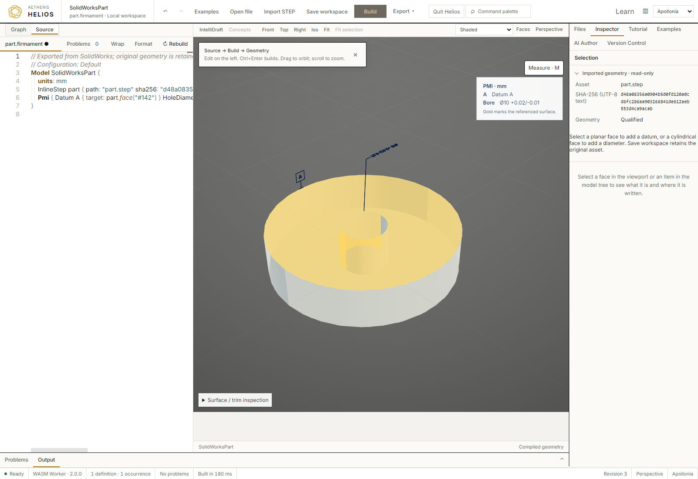

# Aetheris Helios

**Free, open-source CAD for making parts and adding manufacturing information to STEP files.**

Draw visually, edit readable Firmament code, or annotate a part from another
CAD tool. Helios runs locally, powered by the
[Aetheris geometry kernel](https://github.com/yuechen-li-dev/Aetheris).

**[Download for Windows](https://github.com/yuechen-li-dev/HeliosCAD/releases/download/v0.1.0/Helios-0.1.0-win-x64.zip)** · [Release notes](docs/release/0.1.0.md) · [Getting started](docs/public/standalone.md)

## Download and start

1. Download the **Windows x64 ZIP** above.
2. Extract the **entire archive**, then run **Helios.exe**. It opens your browser.
3. Choose a gallery example, **New part**, or **Learn** for a guided tutorial.

Modeling needs no account, API key, .NET installation, or AI subscription.
Use a recent Chrome or Edge browser. The current release is **0.1.0 for Windows x64**.

## Turn a STEP part into an annotated 3D drawing

Already happy modeling in SolidWorks or another CAD tool? Keep using it.
Bring the part into Helios to add manufacturing information and export it with the geometry.

PMI means **product and manufacturing information**: dimensions, datums and
tolerances attached to the part. Helios's current STEP annotation tools let you:

1. **Bring in a part.** Use **Import STEP** for a supported single-part file, or
   the [SolidWorks handoff](docs/public/solidworks.md) for an AP214 export
   (separate add-in setup).
2. **Attach requirements.** In the [Label tab](docs/public/label.md), select faces
   and choose from the datums, diameters and geometric tolerances that fit them.
   Measured sizes are rounded to a nominal you confirm; tolerances are always explicit.
3. **Export the result.** STEP **AP242** carries the geometry and supported
   machine-readable PMI. Annotated **GLB** carries visible 3D callouts and their metadata.
4. **Keep it editable.** **Save workspace** retains the original STEP assets
   and your annotation layer so you can reopen the project later.

These annotations refer to specific faces, so downstream tools can read their
association with the geometry. The SolidWorks handoff uses its ordinary AP214
exporter; this workflow does not require SolidWorks MBD.



*An imported part with an attached datum and diameter tolerance.*

See [supported imports, annotations and export formats](docs/public/exports.md).

## Make your own parts

Choose **New part**, set the box dimensions, then **Preview → Apply**. Select the
body to add holes, pockets, chamfers or fillets. Use **IntelliDraft** for a custom
outline: draw its guides, trace the boundary, then extrude it.
[Follow the first-part walkthrough](docs/public/graph-modeling.md).

**Learn**, or **F1**, opens the offline manual and six guided lessons covering
parts, profiles, manufacturing features, reuse, PMI and assemblies. Edit a working
example beside its instructions.

## A different way to work on a model

If you're coming from Fusion 360 or SolidWorks, the central idea to try is
**a design saved as readable code**, with visual tools for editing that same design.

- **Visual tools and code work together.** The graph and IntelliDraft write
  Firmament. Change a dimension in code, rebuild, and keep working visually.
- **Designs work with Git.** Compare changes and reuse dimensions and definitions.
  The editor provides completion, error underlines, navigation and formatting.
- **AI can work on the same design.** Optional connections edit Firmament with
  build checks and recovery checkpoints. Your chosen provider may receive project
  context. [Connect your client or provider](docs/public/ai-connections.md).
- **Exact geometry, useful exports.** Aetheris's BRep kernel produces STEP solids
  for continued CAD work, with GLB/USD for viewing and supported mesh exports.
- **Local and open source.** Build and export on your computer.
  [AGPL-3.0 licensed](LICENSE).

<details>
<summary>What does a Firmament model look like?</summary>

This makes an 80 × 50 × 8 mm plate with a through-hole. Change `diameter: 8mm`
to `diameter: 12mm`, then press **Build**.

```firmament
Model Plate {
  units: mm
  Box stock { size: [80mm, 50mm, 8mm] }
  Modify stock {
    Hole<Shaft> mount {
      on: +Z
      center: Point2(0mm, 0mm)
      diameter: 8mm
      end: ThroughAll
    }
  }
}
```

The in-app **Learn** section explains the language with complete examples.

</details>

## Save and share

**Save source** keeps your editable design. Use **Save workspace** when the
project has includes or imported STEP assets. **Export** offers STEP AP242,
GLB, USD, STL and OBJ where supported. PDF, SVG and PowerPoint drawings are
available for supported dimensioned part families.

Use **Quit Helios** when you're done; closing the browser tab alone leaves the
local host running. Download working files and keep backups.

## Run Helios as a Claude artifact

Helios can run inside a [claude.ai](https://claude.ai) artifact: a private web
page that Claude publishes for you, which you can open from any browser and
share from its Share menu. The artifact build has the gallery, the editor,
**Learn**, **Open file** and **Import STEP**. It has no accounts, projects,
publishing or AI Author, because those need the Helios server. Saving and
exporting ask you to confirm the download. Files the artifact can't offer
directly, such as `.step`, `.firmament` or `.stl`, arrive inside a `.zip`.

To publish one, give Claude a session with this repository and
[Aetheris](https://github.com/yuechen-li-dev/Aetheris) checked out side by
side (`HeliosCAD/` and `Aetheris/`), then ask:

> Build Helios as a Claude artifact and publish it. Follow "Run Helios as a
> Claude artifact" in the README.

What Claude does:

1. Installs Node 22 and the .NET 10 SDK, then runs `dotnet workload install wasm-tools`.
2. Runs `npm ci`, `npm run sdk:link` and `git checkout package-lock.json` in
   `HeliosCAD/`.
3. Runs `npm run build:artifact`. This writes
   `artifacts/local/helios-artifact/publish.json` with the page, the site
   folder and the list of about 160 files.
4. Publishes with the Artifact tool, passing `file_path`, `root`, `files`,
   `capabilities`, `icon` and `description` from `publish.json` unchanged. To
   update an artifact it published before, it also passes that artifact's
   `url`. `capabilities: { downloads: true }` is what lets saving and
   exporting work.

The artifact runs the trimmed WebAssembly runtime, not the ahead-of-time
compiled one in the Windows release, so large models rebuild more slowly
than in the release.

## Where 0.1 stands

This is an early release. Start with the examples and
[check supported geometry, imports, annotations and drawings](docs/public/exports.md).
The Windows package is unsigned and has no installer or automatic updater.

Found something broken? [Open an issue](https://github.com/yuechen-li-dev/HeliosCAD/issues)
with what you tried, the diagnostic, and a small example you can share.

Want to build from source or contribute? [Developer setup and architecture](CONTRIBUTING.md).
